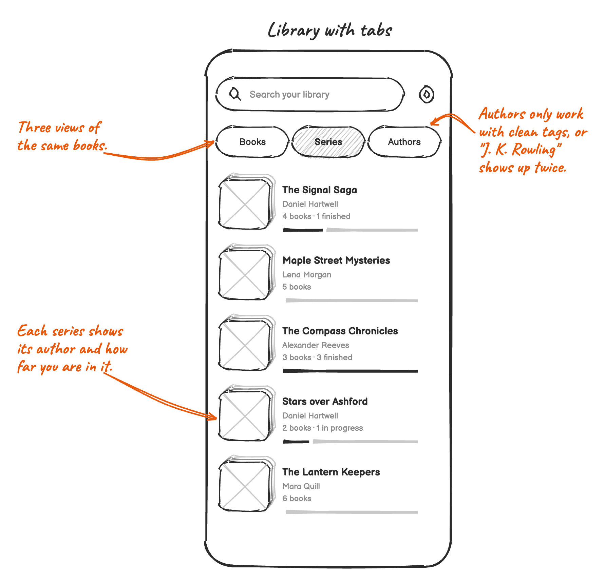
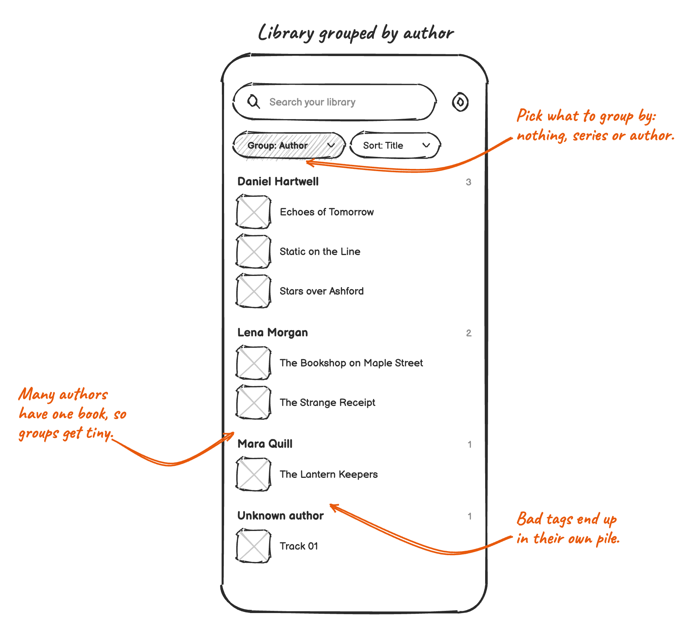
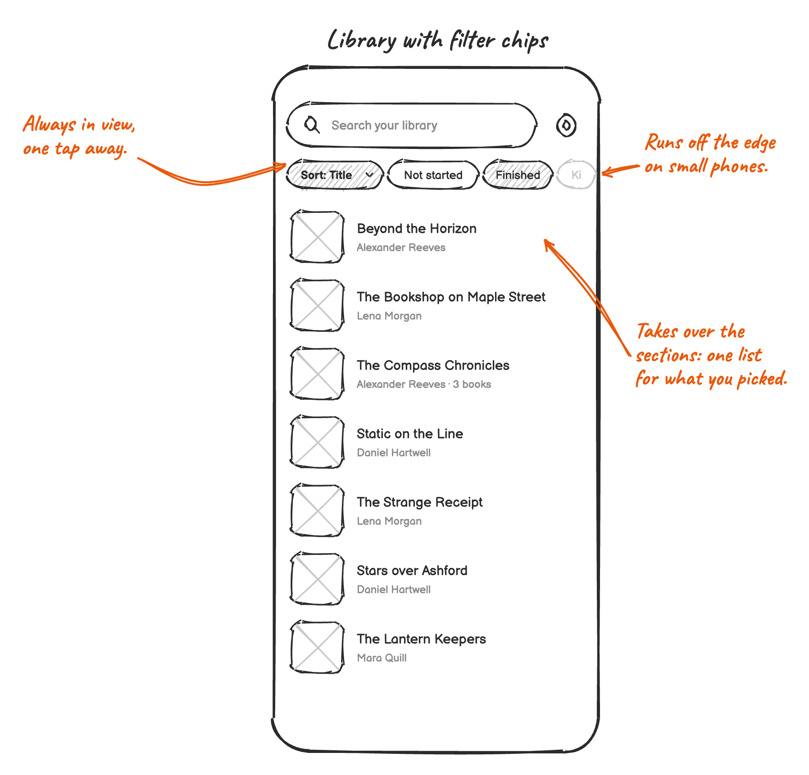

# Library spec (draft)

Listeners with hundreds of books find the next one in seconds, follow their series in order, and keep what they don't
want to see right now out of the way.

This is a proposal with options to decide on. Once something ships, it moves into the [product spec](product.md) and
leaves this page.

## Problems

- **The books of a series are scattered and out of order.** [#1748], [#3313], [#3725]
- **I can't put my books in the order I want.** [#1543], [#3235], [#2909]
- **Fixing the author or the series means editing the files.** [#1407], [#2145]
- **I can't take a book out of my library without deleting its files.** [#3397], [#3166]
- **My library is one long list.** Audiobookshelf libraries with thousands of books, the kids' books next to mine
  ([#2343]).

[#1407]: https://github.com/PaulWoitaschek/Voice/discussions/1407
[#1543]: https://github.com/PaulWoitaschek/Voice/discussions/1543
[#1748]: https://github.com/PaulWoitaschek/Voice/discussions/1748
[#2145]: https://github.com/PaulWoitaschek/Voice/discussions/2145
[#2343]: https://github.com/PaulWoitaschek/Voice/discussions/2343
[#2909]: https://github.com/PaulWoitaschek/Voice/discussions/2909
[#3166]: https://github.com/PaulWoitaschek/Voice/discussions/3166
[#3235]: https://github.com/PaulWoitaschek/Voice/discussions/3235
[#3313]: https://github.com/PaulWoitaschek/Voice/discussions/3313
[#3397]: https://github.com/PaulWoitaschek/Voice/discussions/3397
[#3725]: https://github.com/PaulWoitaschek/Voice/discussions/3725

## What Voice knows today

- Every book has a title, author, narrator, genre, series and part. Search uses all of them and can browse by each. The
  library only shows the title and the author.
- Series and part come from Audiobookshelf and from the `MVNM` and `MVIN` tags of MP3 files. M4B files most likely lose
  them, because media3 hands these tags over under a different id. Folder names never become an author or a series,
  not even with "Folders are authors".
- The author is the artist tag. It often holds the narrator, several names, or one person spelled two ways.
- Only the title and the cover can be changed, and only for books on the device. The title syncs through `.voice`.
  Voice never writes tags.
- Not started yet, Current and Completed follow from the position. Current and Completed are in the order they were
  last listened, Not started yet by title. There's no sorting, filtering or hiding.

**So: group by series, not by author.** A series is short, ordered by its parts, and comes from Audiobookshelf or the
tags. Authors are messy, most of them have a single book, and a group per author makes the list longer, not shorter.
Authors are for search, sorting and editing.

## Ground rules

- The library stays one calm screen. Nothing new to learn for a listener with ten books.
- No book gets lost. Search always finds grouped and hidden books.
- Edits never touch the files or the server.
- Grouping series needs no setting.

## 1. Series in the library

### A. A series is one stack (recommended)

- Two or more books of a series show as one stack, with the author and how many are finished. A single book of a
  series shows as a book.
- The book in Continue listening shows on its own, with its series and part under the title. Its series shows nowhere
  else.
- Any other series is in Current once one of its books is started, also between two books. It's in Not started yet
  before that, and in Completed once all are finished.
- A tap on a stack opens the series.

Nothing to learn, the list gets shorter on its own, and it works the same for ten books and for five thousand.

### B. Tabs for books, series and authors

Familiar from other players. But a book is in three places, the Books tab is still one long list, Authors depends on
clean tags, and search already browses by author and series.

### C. Group by, as a choice

Flexible, but it's a setting most listeners never find. Grouping by author makes many groups of one and an "Unknown
author" pile, and the headers fight with the sections.

Shelves per series or genre, like in streaming apps, are good for browsing a few books and slow for finding one in a
thousand. Not pursued.

## 2. The series

- The cover stack, the name of the series, its author and how many books are finished.
- One button continues the book in progress, or starts the first book that isn't finished.
- Books in the order of their parts. Books without a part come after them, by title, with 2 before 10.
- More options: rename the series for all its books, hide the series.
- Opens from a stack, from the series under a book's title in the player and the book actions, and from Browse in
  search, which today only fills in the search field.

## 3. Sorting and filtering

### A. One sheet behind a button (recommended)

- **Sort by:** Last listened, Title, Author, Recently added. Last listened is the default and is what the library does
  today, because books that weren't started fall back to their title. The order applies to Not started yet and
  Completed. Current stays in the order it was listened in. Author sorts by author, then series and part, then title.
- **Show:** finished books, hidden books.
- **From:** one chip per audiobook folder and Audiobookshelf library, only with more than one.
- A dot on the button says that not everything is shown.
- Filtering by author, narrator or genre stays in search, which already does it.

### B. Filter chips above the list

Always in sight. But it's a row of controls for every listener, also for those with twelve books, it runs off the edge
on small phones, and it turns the sections into one flat list.

## 4. Hiding books

### A. Hide a book or a series (recommended)

- Hide from library in the book actions, for a series on the series screen, and for selected books. A snackbar offers
  to undo it.
- Hidden books leave the library, Continue listening, the Shelf widget and Android Auto. Search still finds them,
  marked as hidden.
- Hidden books in the sort sheet shows them again, and the book actions unhide them.
- Progress, bookmarks and files stay, and a scan doesn't bring the book back. This also solves removing a book without
  deleting its files ([#3397]).
- Hiding syncs through `.voice`, so a book hidden on the phone is hidden on the tablet too.

### B. Hide a whole folder or server library

The From chips in the sort sheet. For a folder of kids' books, or a second Audiobookshelf library. Worth it once A is
out and listeners still ask for it.

### C. Fold away Completed

Completed shows only its count and opens with a tap. Smaller than A, but it doesn't help with books that were never
started.

## 5. Editing title, author and series

### A. An edit sheet for each book (recommended)

- Edit replaces Rename, with title, author, series and part.
- The series field suggests the series in the library, so the same series isn't there twice with two spellings.
- "Use the names from the files" undoes all edits.
- Edits override the files, stay in Voice and sync through `.voice` like the title does today.
- Books from Audiobookshelf are edited on the server, like their title and cover today. The server has better tools
  for it and keeps every device in step.

### B. Edit several books at once

- Select in the book actions starts selecting, and a tap adds more books. Then Series, Author or Hide for all of them.
- Parts follow the titles, 2 before 10, and can be fixed on the series screen.

Fixes a messy library in minutes, like 40 episodes of a radio play without a series tag. It's a new mode, though. Worth
it if A alone turns out to be too slow.

### C. Read more from the files first

Every series the files already name is one less to type in. Reading series and part from M4B files is a bug fix that
belongs in this work either way.

## 6. The next book in a series

- When a book of a series ends, the player offers the next one, the first unfinished book after it by part.
- Continue listening in the library offers it too, until another book is started.
- It never starts on its own, so a book that ends while the listener falls asleep doesn't run into the next one.

## Won't solve

- **Grouping by author:** tags are too messy for it, and Browse in search already lists authors.
- **Own collections or shelves** ([#2343]): every list is something the listener has to keep up. Series, hiding and
  search cover most of what's asked for.
- **Writing tags into the files:** it could break files, and synced folders would change on every device.
- **Putting books in any order by hand** ([#1543]): sorting and the order of a series cover what listeners describe.
- **Sorting by file name** ([#3235]): editing the title or the series fixes the order for good.

## Left out for now

- Two series with the same name from different authors become one.
- A book in several series only shows in the first one, like today.
- Books from Audiobookshelf have no `.voice` folder, so they stay hidden only on the device they were hidden on.
- Android Auto and the widgets don't offer the next book of a series.

## Order of work

Each step helps on its own.

1. Read series and part from M4B files.
2. The edit sheet with author, series and part.
3. Series stacks in the library and the series screen.
4. Offering the next book of a series.
5. Hiding books.
6. The sort sheet.
7. Selecting several books, if still needed.

## Open questions

- Should books from Audiobookshelf be editable in Voice after all?
