# Library spec (draft)

Listeners with hundreds of books find the next one in seconds, follow their series in order, and keep what they don't
want to see right now out of the way.

This is a proposal. Once something ships, it moves into the [product spec](product.md) and leaves this page. To try
it, open the [clickable prototype](https://voice.woitaschek.de/prototypes/library/index.html).

## Problems

- **The books of a series are scattered and out of order.** [#1748]
- **I can't put my books in the order I want.** [#1543]
- **Fixing the author or the series means editing the files.** [#1407]
- **I can't take a book out of my library without deleting its files.** [#3397]
- **My library is one long list,** with thousands of books from Audiobookshelf, or the kids' books next to mine. [#1214]
- **With thousands of books, I want to go through them by author,** like in Audiobookshelf. [#3946]
- **The episodes of a radio play all look the same, and search can't find one by its number.** [#3132]
- **My author folders don't make authors, and a series folder becomes one long book.** [#3162]

[#1214]: https://github.com/PaulWoitaschek/Voice/discussions/1214
[#1407]: https://github.com/PaulWoitaschek/Voice/discussions/1407
[#1543]: https://github.com/PaulWoitaschek/Voice/discussions/1543
[#1748]: https://github.com/PaulWoitaschek/Voice/discussions/1748
[#3132]: https://github.com/PaulWoitaschek/Voice/issues/3132
[#3162]: https://github.com/PaulWoitaschek/Voice/discussions/3162
[#3235]: https://github.com/PaulWoitaschek/Voice/discussions/3235
[#3397]: https://github.com/PaulWoitaschek/Voice/discussions/3397
[#3946]: https://github.com/PaulWoitaschek/Voice/discussions/3946

## What Voice knows today

- Every book has a title, author, narrator, genre, series and part. The library shows the title and the author, and
  two or more books of a series as one stack. Search only lists books.
- Series and part come from Audiobookshelf, and from the tags the usual taggers and Audiobookshelf write into MP3,
  M4B, FLAC, OGG and MKA files.
- A book of one file is named after its album. 160 episodes with the album "Die drei ???" all get that name, and their
  own titles are neither shown nor searched.
- The author is the artist tag. It often holds the narrator, several names, `<Unknown>`, or one person spelled two
  ways.
- Folder names never become an author or a series. With "Folders are authors", a series folder in an author's folder
  becomes one long book.
- Only the title and the cover can be changed, and only for books on the device. Voice never writes tags.
- Current and Completed are in the order they were last listened, Not started yet by title. There's no sorting,
  filtering or hiding.

**So: group by series, and by author only when sorted by author.** A series is short and ordered by its parts. Authors
are messy and most of them have a single book, so they only group when the listener asks for them. Libraries with
thousands of books mostly come from Audiobookshelf, where the authors are clean and have many books each.

**But most series aren't in the tags.** They're in the album or in the folders, so Voice reads them from there, and
fixing many books at once has to take a few taps.

## Ground rules

- The library stays one calm screen. Nothing new to learn for a listener with ten books.
- It stays quick with 5,000 books and a series of 200 episodes.
- No book gets lost. Search always finds grouped and hidden books.
- Edits never touch the files. Edits of a book from Audiobookshelf are saved on the server.
- Grouping needs no setting.

## 1. Series in the library

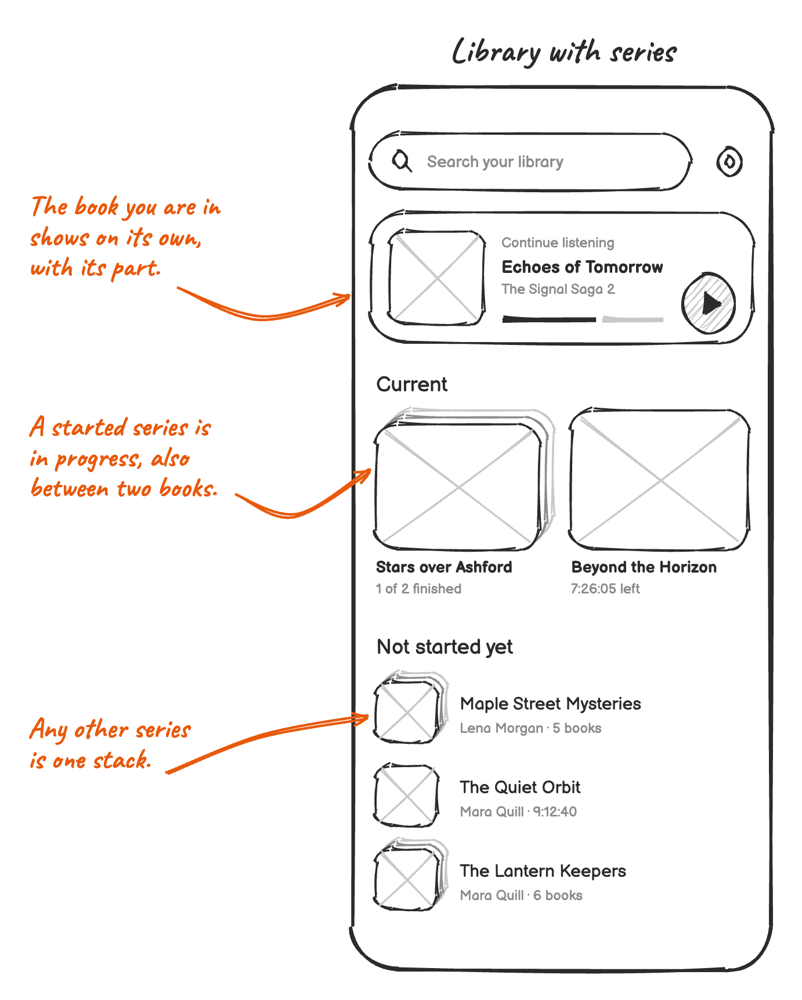

Series stacks are in the library, see the [product spec](product.md#library). Still to come:

- A long press on a stack renames or hides it.
- The orders other than Progress show every series as one stack in All books, see Sorting and filtering.

## 2. The series

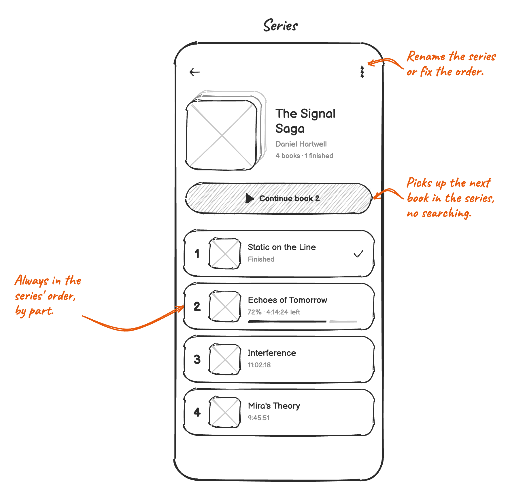

The series screen opens from a stack, see the [product spec](product.md#library). Still to come:

- More options rename the series for all its books, or hide it. Picking a suggested name joins the two series.
- It also opens from a book's series in the player and the book actions, and from search.

## 3. The author

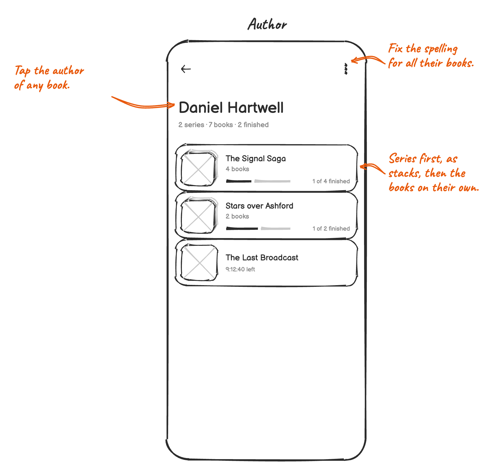

- The author's name, how many series and books they have, and how many are finished.
- Their series first, as stacks, then their other books by title.
- Names that only differ in case, spaces or punctuation are one author, like "jk Rowling" and "J. K. Rowling", shown in
  the spelling most of their books have. Series names match the same way.
- More options rename the author for all their books. Picking a suggested name joins the two, like ten books of
  "Rowling, J. K." and ten of "J. K. Rowling". Renaming leaves out books from Audiobookshelf, like Author does for
  selected books.
- Opens from an author's stack in the library, a book's author in the player, the book actions and the series, and
  from search.

## 4. Where series and authors come from

An edit in Voice comes first, then Audiobookshelf and the tags, then the folders, and last the album.

- **Tags:** `SERIES` and `SERIES-PART`, then the show and its episode, then `MVNM` and `MVIN`, like Audiobookshelf reads
  them. Without these, a grouping like "The Stormlight Archive #2" names the series. A grouping without a part is often
  a genre, so it doesn't count.
- **Authors:** the artist tag, or the album artist when there's none. "Unknown" and `<Unknown>` count as no author.
  With "Folders are authors", the folder is the author of books whose tags have none. The tags come first, because
  some listeners use this mode for folders like "Kids" or "Crime".
- **Album:** books of one file in the same folder that share an album are a series named after the album, and each is
  named after its own title. 160 episodes called "Die drei ???" become one stack, with episodes like
  "Folge 63: Monster-Wolken" in it. Albums like "Unknown" or "Audiobook" don't count, and a book whose title is only a
  number or like "Track 01" keeps the album's name.

### Series folders

With "Folders are authors", every folder in an author's folder is one book today. `Rowling/Harry Potter/` is one book
of over 100 hours, even when it holds seven book folders. The folder preview already spots these and says
"Looks like 7 books".

Such a folder becomes a series when it holds no audio files itself, and at least two of its folders hold audio and
aren't named like discs. Each of those folders is a book with everything in it, in the order of their names. Anything
else stays one book, like today. The preview uses the same rule.

A disc is a number on its own or after CD, Disc, Disk, Tape, Side, Part, Teil or Vol, like "07", "CD 2",
"My Book - Disc 02" or "Part 3", or a name that starts with CD, Disc or Disk and a number, like "CD1 - The Beginning".
These are the names the preview knows today, plus the last kind.

Where a book begins and ends only follows the folders, never the tags. A changed tag never splits or joins books, the
preview shows the result without reading the files, and it's the layout Audiobookshelf uses: `Author/Series/Book/CD 1`.
When in doubt, it stays one book. A long book can still be listened to, but a book that was split by mistake can't be
joined again. That's why "Part 3" counts as a disc.

| In `Author/X/` | Result |
|---|---|
| `The Swarm/01.mp3`, `02.mp3` | One book |
| `The Swarm/CD 1/`, `CD 2/`, `Scans/` | One book |
| `The Swarm/CD1 - The Beginning/`, `CD2 - The Escape/` | One book |
| `Harry Potter/1 Philosopher's Stone/`, `2 Chamber of Secrets/` | A series of two books |
| `Harry Potter/1 Philosopher's Stone/CD 1/`, `CD 2/` | Book 1 holds both CDs |
| `Discworld/Discworld 01/`, `Discworld 02/` | A series of two books |
| `Harry Potter/Part 1/`, `Part 2/` | One long book, like today |
| `The Swarm/Part 1 - The Beginning/`, `Part 2 - The Escape/` | A series, by mistake |

For books already in the library:

- The first scan after the update splits these books without asking.
- Bookmarks and the listening history move to the book their file is in, and the position to the book that was
  playing, like when a folder's mode changes today.
- New: the books before the one that was playing are marked Completed, and the new books keep the date the long book
  was added.
- A name or cover set on the long book is lost, because the new books take their names from their files.

## 5. Sorting and filtering

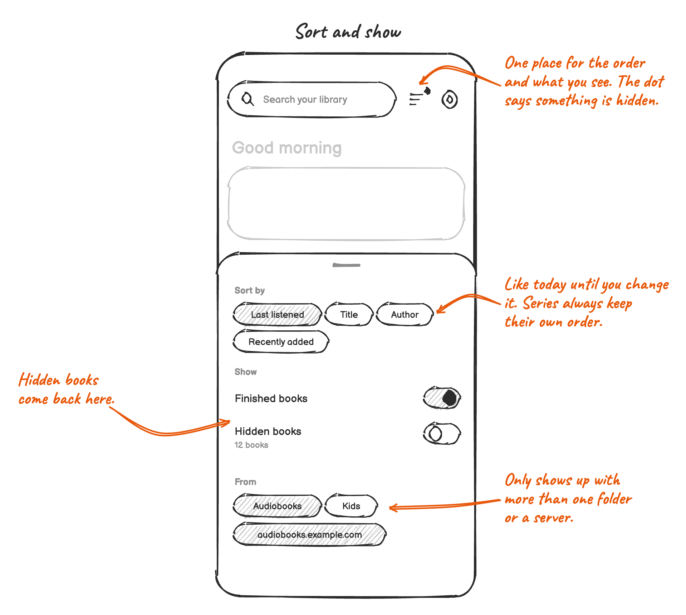

- **Sort by:** Progress, Title, Author, Recently added.
- Current is always on top, in the order it was listened in, so the books in progress are one tap away in every order.
  A started series is a stack in it, like with Progress.
- **Progress** is the default and the library of today: below Current come Not started yet by title and Completed
  by last listened. A series there sorts by its name or by its last listened book.
- **Title, Author and Recently added** show the whole library below Current, in one list called All books. Every
  book is in it once, also the ones in progress and the finished ones, and two or more books of a series are one
  stack. One order is easier to follow than one per section.
- Title sorts books by their title and series by their name. Author sorts by author and stacks their books, see
  below. Recently added puts the day or the month above the books added in it, newest first.
- Inside a stack, the order of the series always holds.
- **Show:** finished books, hidden books. Without finished books, Completed is gone, and books and stacks that are
  all finished leave All books. A stack with a book still to listen keeps all its books, so its counts stay right.
- **From:** one chip per audiobook folder and Audiobookshelf library, only with more than one.
- A dot on the button says a filter is on: finished books are off, or a folder is. Hidden books don't count, because
  they're hidden on purpose.
- Filtering by author, narrator or genre stays in search.

### Sorted by author

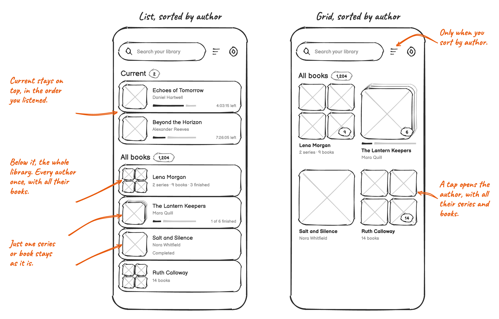

- Two or more series or books of an author are one stack in All books, with all their books: in progress, finished
  and not started. An author with just one series or book shows it as it is.
- The stack has the author's name, how many series and books are in it and how many are finished, and four of their
  covers side by side, so it doesn't look like a series. The grid counts the books in a badge, like on a series.
- A series belongs to the author most of its books have, so a series with a co-author stays one stack.
- A tap opens the author. A long press offers to hide all their books, and to rename the author when some of their
  books are on the device.
- Authors are in the order of their names. Books with no author come last, under No author.

### Sorted by recently added

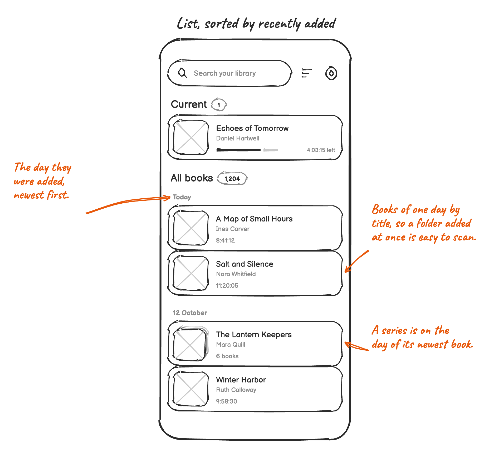

- Books from the last 30 days are under the day they were added, like Today, Yesterday or 12 October. Older books
  are under their month, like September or March 2025, so a library that grew over years doesn't become hundreds of
  short sections. Newest first.
- The books of one day or month sort by title, because a folder added at once would otherwise be in the order of the
  scan.
- A series goes where its newest book is, and sorts by its name.
- Books added before Voice kept the date come last, under Earlier.

## 6. Hiding books

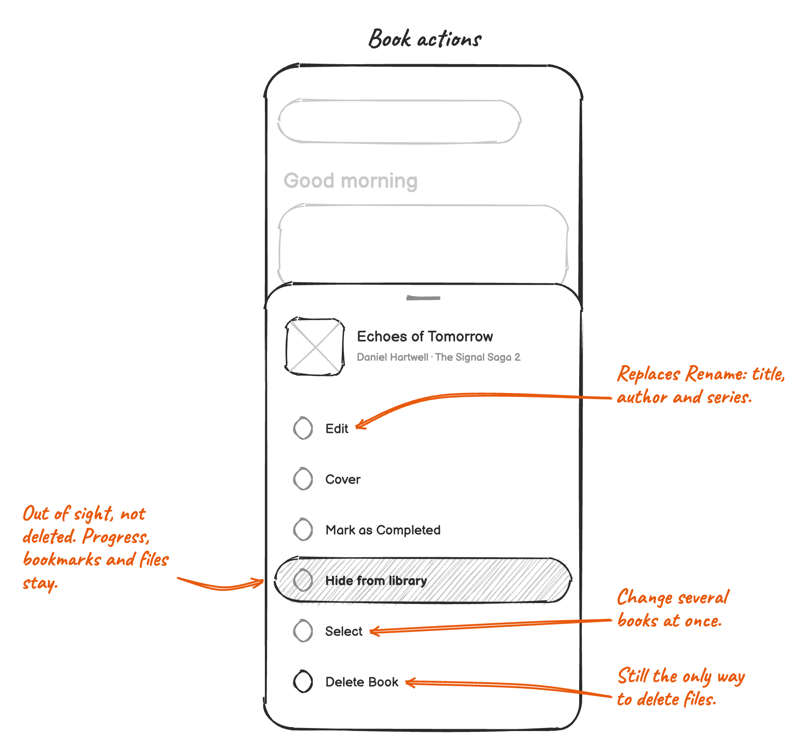

- Hide from library in the book actions, on a series' or an author's stack or screen, and for selected books. A snackbar offers to
  undo it.
- Hidden books leave the library, Continue listening, the Shelf widget and Android Auto. Search still finds them,
  marked as hidden. The sort sheet shows them again, and the book actions unhide them.
- Progress, bookmarks and files stay, and a scan doesn't bring the book back.
- Hiding syncs through `.voice`, like the name does.

## 7. Editing title, author and series

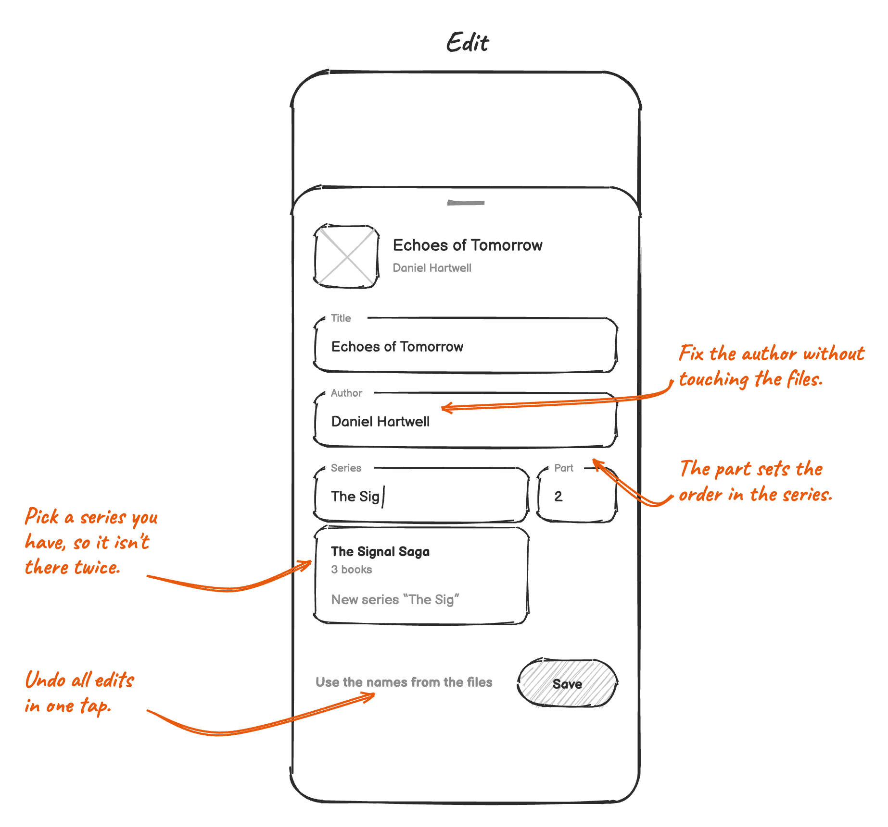

- Edit replaces Rename, with title, author, series and part. The author and series fields suggest the names in the
  library, so one name isn't there twice.
- "Use the names from the files" undoes all edits.
- Edits stay in Voice and sync through `.voice`, like the name does. What wasn't edited still follows the files, so a
  fixed tag shows up in Voice.
- Save writes the edits of a book from Audiobookshelf to the server, so every app connected to it shows the same
  book. Several authors are separated by commas, like Voice shows them. The cover is still edited on the server.

### Several books at once

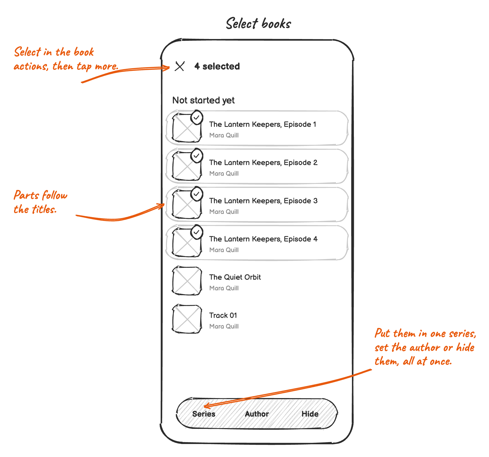

- Select in the book actions starts selecting, because a long press already opens them. A tap adds a book, a tap on a
  stack all its books, and Select all everything shown.
- Selecting works in the library, on a series, on an author and in search results. To fix a radio play, search for
  it, select all and set the series.
- Series, Author and Hide change all selected books. Books put in a series follow their folder or file names. Series
  and Author leave out books from Audiobookshelf, and say how many they left out.

## 8. The next book in a series

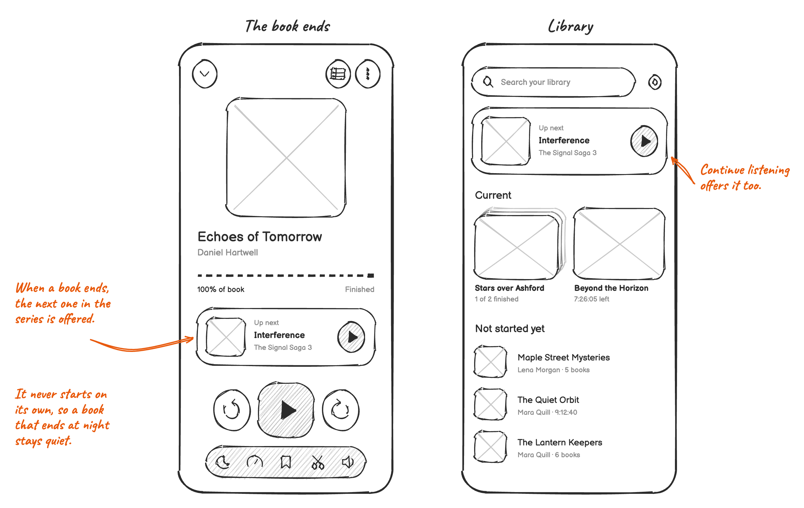

- When a book of a series ends, the player offers the next one: the first unfinished book after it in the series.
  Finished books are skipped, so a book read on paper only needs to be marked Completed.
- Continue listening in the library offers it too, until another book is started.

## 9. Search

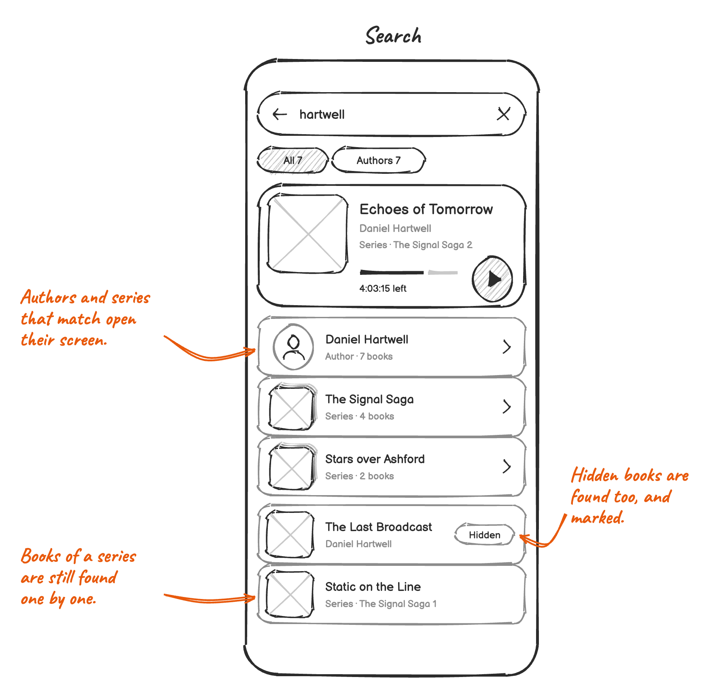

- The best match stays on top and plays in one tap. Authors and series that match come right below it, and open their
  screen.
- Books are still found one by one, also those in a series and hidden ones.
- Browse opens the author's or the series' screen. Narrators and genres match whole names, so "Stephen King" no longer
  finds "Stephen Kingsley". A field with several names, like "Fantasy, Young Adult" from Audiobookshelf, matches each
  of them.
- A series and a part work in one search, so "signal saga 3" puts Interference first. Numbers match as a whole and
  without leading zeros, so "63" finds "Folge 063" but not "Folge 163".
- Asking Android Auto to play something uses the same search instead of its own. "Play The Signal Saga" plays the book
  that's next. Chapter names are no longer searched there.

## 10. Voice finds the books

The three layouts are hard to understand, and many libraries fit none of them ([#3162]): M4B files next to author
folders, and series folders in some of those. Instead, Voice looks at each folder on its own, and the listener fixes
what it gets wrong.

**The plan is to replace all three layouts with this.** An A/B test with new listeners shows first whether it works as
well as the layouts. Until then, no library that's already set up changes.

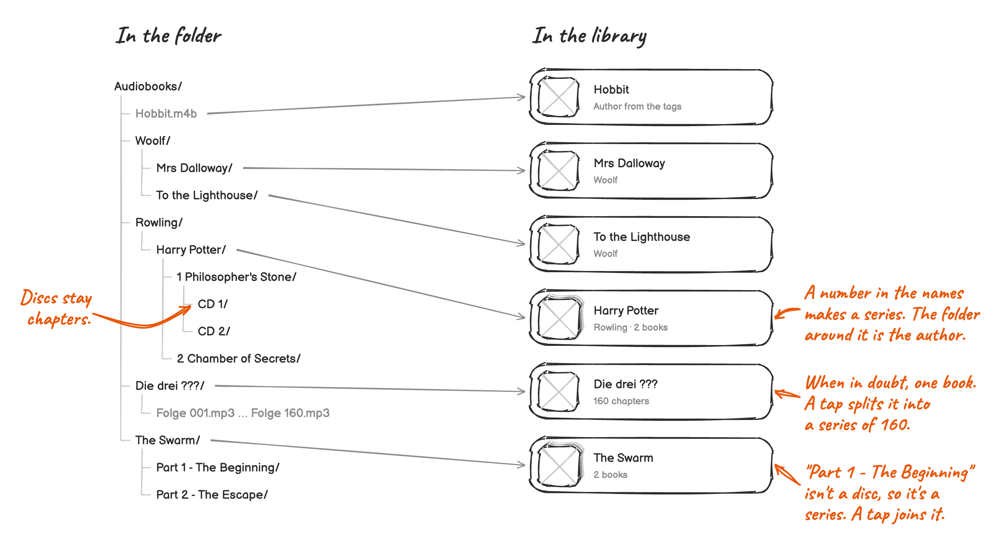

**Finding books**

- Every folder gets the guess the preview makes for the picked folder today. A folder that looks like one book is one
  book, with its files and disc folders as its chapters. Any other folder holds books: each file in it is a book, and
  each folder in it gets the same look.
- Like in the other layouts, tags never decide where a book begins or ends.
- Tags and edits name the author and the series first. Otherwise a folder of books is their series when most of their
  names have a number, like "1 Philosopher's Stone" or "Discworld 01", and their author when they don't. The folder
  around a series is its author. The picked folder is never an author, because it's mostly called "Audiobooks".

| In the picked folder | Result |
|---|---|
| `Hobbit.m4b`, `Woolf/Mrs Dalloway/`, `Woolf/To the Lighthouse/` | Three books, two of them by Woolf |
| `Rowling/Harry Potter/1 Philosopher's Stone/`, `2 Chamber of Secrets/` | A series by Rowling with two books |
| `The Swarm/CD 1/`, `CD 2/` | One book |
| `Die drei ???/Folge 001.mp3` to `Folge 160.mp3` | One book with 160 chapters, until it's split |
| `The Swarm/Part 1 - The Beginning/`, `Part 2 - The Escape/` | A series, until it's joined |

**Fixing what it gets wrong**

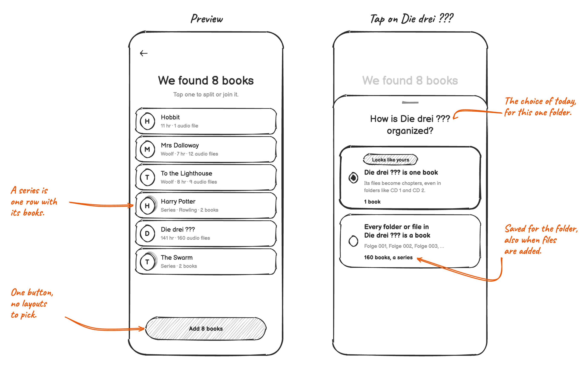

- The preview shows the books and series Voice found, with one button to add them. A tap on one asks how its folder
  is organized, with two of today's options: it's one book, or every folder or file in it is a book. The preview is
  there when adding a folder, and later in the folder settings.
- A split or a join is saved for the folder and wins over the guess, also when files are added later.

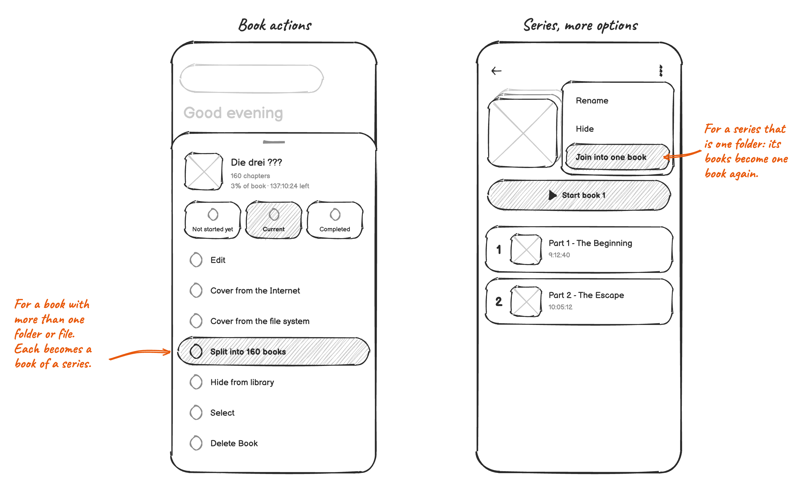

- A book with more than one folder or file in it can be split in its actions: "Split into 7 books". Its folder then
  holds books, like any other folder of books.
- A series that's one folder can be joined on its screen: "Join into one book".
- Position, bookmarks and the listening history move along, like when the layout changes today. A name or cover set on
  the books that are split or joined is lost.

### Testing it with new listeners

- In the Play build, Remote Config puts half of the listeners who start Voice for the first time in a test group. The
  group is set before the first folder is added and kept, so a library never changes because Remote Config did.
- The test group only gets this way of finding books, with no layouts to pick, because a split or a join can make
  every result the layouts make. The other half gets the layouts like today.
- Listeners who already have folders, and the F-Droid build, aren't part of the test.
- With the listeners who agreed to analytics, it compares how many add a folder and start a book on the first day, and
  how many still listen after one and after four weeks. Next to it: how often the test group splits and joins, against
  how often the other group changes the layout.
- When the test group does at least as well, the layouts are replaced. If not, its folders move to the layout the guess
  picks, and progress stays, like with every change of the layout.

### Replacing the layouts

Once the test shows it works, it becomes the only way Voice finds books, also for the folders that are already added.
They move over with a split or a join saved for them, so only books that look like several books change:

| Today | Moves over as | Books that change |
|---|---|---|
| A single file | A single file | None |
| One book | The folder joined | None |
| Every folder is a book | The folder split | Folders that look like several books, like a folder of book folders or of M4B files |
| Folders are authors | The folder and each folder in it split | The series folders above |

Saving a join for those folders too would keep every book as it is. Then nothing changes for listeners, and only
folders added later work the new way.

What stays:

- A book is a folder or a file. Book ids, progress, bookmarks, `.voice` and Audiobookshelf stay as they are.
- Adding a single file, and picking the folder of one book.
- The preview before adding, the disc names, and M4B files and files over 200 MB as books of their own.
- Folders as authors and series, now at any depth and not only with "Folders are authors".

What goes:

- The sheet "How is X organized?" and its three options. The preview shows the books found, and split and join fix
  them.
- "Every folder is a book" and "Folders are authors" in the folder settings, and most of
  [How does Voice find the books in my folder?](https://voice.woitaschek.de/faq/#folders).
- The hint "Looks like 7 books", which becomes Split.

## Won't solve

- **Writing tags into the files:** it could break files, and synced folders would change on every device.
- **Fewer books in Current:** it shows every book in progress, also the dozens Audiobookshelf can bring. Mark as not
  started yet and Hide clear it up.
- **Putting books in any order by hand:** sorting and the order of a series cover what listeners describe.
- **Sorting the whole library by file name** ([#3235]): books in a series follow their parts, then their names, which
  mostly come from their folders or files, and editing fixes the rest.
- **Splitting a book at a chapter, or joining books from different folders:** a book stays one folder or one file, so
  its progress, bookmarks and sync keep working.

## Left out for now

- Playing the next book on its own. A book that ends while the listener falls asleep would run into the next one.
- Android Auto still lists all books in one list. Neither it nor the widgets follow the sort or offer the next book
  of a series.
- Books from Audiobookshelf have no `.voice` folder, so they stay hidden only on the device they were hidden on.
- Until every device has the update, a split series folder and the long book it was don't sync their places.
- Two series with the same name from different authors become one, and a book in several series only shows in the
  first one.
- Books of a series without a part follow their names, not their file names, because Voice doesn't keep the file
  names of a book.
- An author tag with several names gets one author screen and one stack for all of them. Names in another order, like
  "Rowling, J. K.", are joined by one rename.
- Authors sort by their name as it's written, so "Stephen King" comes under S, not K.
- Folders only become series with "Folders are authors", or with "Voice finds the books".
- Search doesn't look through chapter names or file names.
- Books on the device count as added on the day they're scanned, so on a new phone or a second device, the whole
  library is added that day.
- In All books, a book in a stack isn't under its own title, like "The Way of Kings" in "The Stormlight Archive" under
  S. Search finds it.
- Splits and joins stay on the device and don't sync through `.voice`.

## Order of work

Each step helps on its own.

1. Radio plays and other episodes: each file keeps its own title, and files that share an album become a series.
2. "Folders are authors": the folder is the author of books whose tags have none.
3. The edit sheet with author, series and part.
4. Offering the next book of a series.
5. Series folders with "Folders are authors". It changes which files make a book.
6. The author screen.
7. Authors and series in search, Browse opening their screen, and numbers in search.
8. Hiding books.
9. The sort sheet, with All books for the orders other than Progress.
10. Author stacks when sorted by author. They open the author screen from step 6.
11. Selecting several books.
12. Android Auto using the library search.
13. "Voice finds the books", as an A/B test with new listeners.
14. If the test works, replacing the layouts for everyone.

## Open questions

- Are folders enough as shelves ([#1214]), or do listeners need shelves they make in Voice?
- Should step 5 go, since replacing the layouts splits series folders anyway, and no library changes before the test?
- When the layouts are replaced: should folders that look like several books be split, or keep their books with a join?
- Do listeners with thousands of books need a fast scroller with letters, when sorted by title or author?
