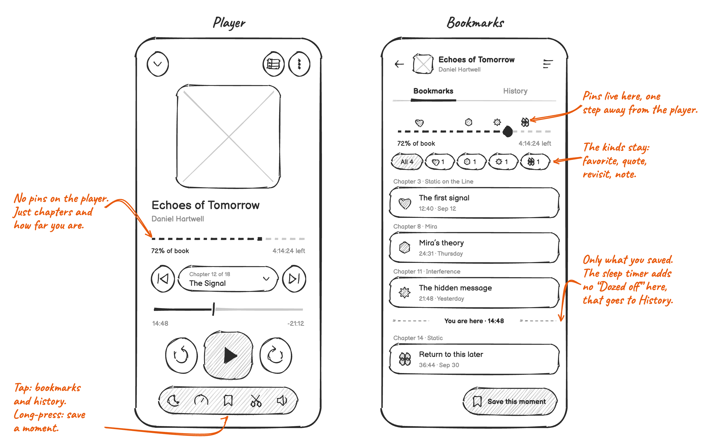
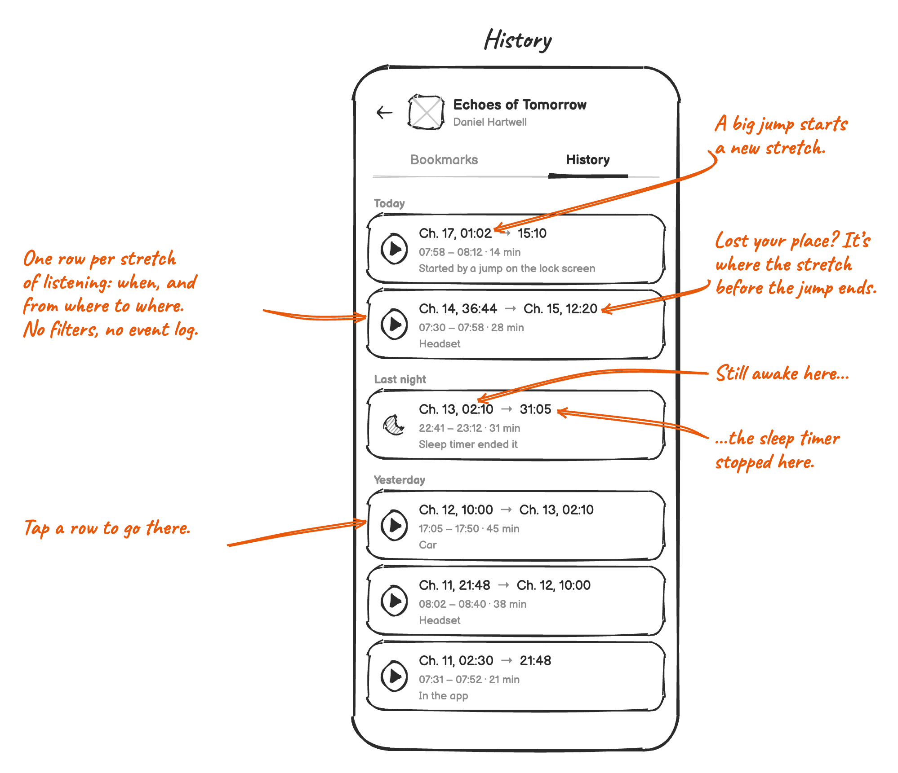

# Bookmarks and history

**Status:** Outline.

Listeners keep the moments that matter, and they can always get back to where they were.

**When:** While listening, often away from the screen: walking, driving, cooking. Later, when studying a book or
looking for a scene. And right after an accidental tap or seek.

Bookmarks are what the listener saved. Everything Voice records by itself goes into the history.

| Problem | Status |
|---|---|
| [Saving a moment means stopping](#saving-a-moment-means-stopping) | ✅ Solved |
| [Saving a moment means taking out the phone](#saving-a-moment-means-taking-out-the-phone) | ⭕ Open |
| [I can't find the bookmark I'm looking for](#i-cant-find-the-bookmark-im-looking-for) | ✅ Solved |
| [My bookmarks get lost among automatic ones](#my-bookmarks-get-lost-among-automatic-ones) | 🔜 Planned |
| [A tap or a seek loses my place](#a-tap-or-a-seek-loses-my-place) | ✅ Solved |
| [Finding a lost place in the history means reading a log](#finding-a-lost-place-in-the-history-means-reading-a-log) | 🔜 Planned |
| [My notes can't leave the app](#my-notes-cant-leave-the-app) | ⭕ Open |
| [Bookmarks of server books are only on this phone](#bookmarks-of-server-books-are-only-on-this-phone) | ✅ Solved |

Losing bookmarks on a new phone or after moving files is in [Servers, sync and backup](servers-and-sync.md) and
[Getting started](getting-started.md).

## Saving a moment means stopping

✅ **Solved** · [#3368]

Listeners notice a moment after they heard it, often with their hands full. Stopping to fill in a form breaks the story.

**Solution:**

- Long-press the bookmark button to save right away.
- Save first, add details after: a kind (favorite, quote, note, revisit), a note, and moving the mark 15 seconds
  earlier or later.

**Turned down:**

- Dropping the kinds: a heart or a quote shows at a glance why a moment was saved, and picking one is optional, after
  saving.

## Saving a moment means taking out the phone

⭕ **Open** · [#1289]

Even a long-press needs the phone in hand and Voice open.

## I can't find the bookmark I'm looking for

✅ **Solved** · [#3168]

With many bookmarks, the newest one ends up on top even when it's about an earlier part of the book.

**Solution:** Story order with chapter headers and "You are here", or recently saved first. The kinds work as filters,
pins show where each bookmark is in the book, and swiping deletes with undo.

**Turned down:**

- A separate notes feature: bookmarks already are notes ([#2123]).

## My bookmarks get lost among automatic ones

🔜 **Planned**

The automatic sleep timer adds a bookmark every night. They push the listener's own bookmarks apart in the list, and on
the player's progress bar they pile up into a cluster nobody can read.

**Solution:**

- Bookmarks are only what the listener saved. The sleep timer stops adding them, and the night shows up in the history
  instead (see [Sleep timer](sleep-timer.md)).
- Pins only on the bookmarks screen. On the player, the book bar shows chapters and progress. Bookmarks are a detail one
  step away, not something you need while listening.

## A tap or a seek loses my place

✅ **Solved** · [#454]

After an accidental tap, a seek or opening a bookmark, listeners can't get back to where they were.

**Solution:**

- The jump-back pill, right after a big seek or a chapter change (see [Player](player.md)).
- The listening history: a timeline of plays, pauses, jumps and sleep, showing what caused each one, like the app,
  headphones or the car. You can jump back from any entry. It's always on, because a switch and a clear button were
  more than it needs ([#3824]).

**Turned down:**

- Saving a bookmark before every jump: a slip that already happened couldn't be undone ([#3805]).

## Finding a lost place in the history means reading a log

🔜 **Planned**

Every play, pause, skip, setting change and bookmark is a row of its own, with filters by type and by source,
"Lost your place?" suggestions, and undo for settings and deleted bookmarks.

**Solution:** The history lists stretches of listening: when, and from where to where in the book. A big jump starts a
new one, so the place before an accidental jump is where the stretch before it ends. A stretch the sleep timer ended
says so. What started or stopped it, like headphones or the car, is a small line, not a filter. Tapping a row goes
there. Settings and bookmarks aren't in the history anymore, and deleting a bookmark already has undo in the list.

**Turned down:**

- Filters by type and by source: a list of stretches has nothing left to filter.
- "Lost your place?" suggestions: the pill offers the way back right away, and later the list shows it without
  guessing.

**Assumption:** Where each stretch ends is enough to find a lost place, without seeing every skip and pause. Guess.

## My notes can't leave the app

⭕ **Open** · [#2549]

Listeners who study a book want their bookmarks and notes as text, outside Voice.

**Turned down:**

- Import and export: too much work for what most listeners get out of it ([#367]). That was in 2016.

## Bookmarks of server books are only on this phone

✅ **Solved**

**Solution:** Bookmarks sync with Audiobookshelf, except the ones the sleep timer sets.

## Open questions

1. Export: ten years after "too much work", does the principle that "the data stays with the listener" change the
   answer? A text export is much smaller than a full backup.
2. A book's history follows it to a new id after a rescan. Does that fix losing bookmarks after a move ([#2636])?
3. What happens to the "Dozed off" bookmarks listeners already have?

[#367]: https://github.com/PaulWoitaschek/Voice/issues/367
[#454]: https://github.com/PaulWoitaschek/Voice/issues/454
[#1289]: https://github.com/PaulWoitaschek/Voice/discussions/1289
[#2123]: https://github.com/PaulWoitaschek/Voice/discussions/2123
[#2549]: https://github.com/PaulWoitaschek/Voice/discussions/2549
[#2636]: https://github.com/PaulWoitaschek/Voice/issues/2636
[#3168]: https://github.com/PaulWoitaschek/Voice/discussions/3168
[#3368]: https://github.com/PaulWoitaschek/Voice/discussions/3368
[#3805]: https://github.com/PaulWoitaschek/Voice/pull/3805
[#3824]: https://github.com/PaulWoitaschek/Voice/pull/3824
